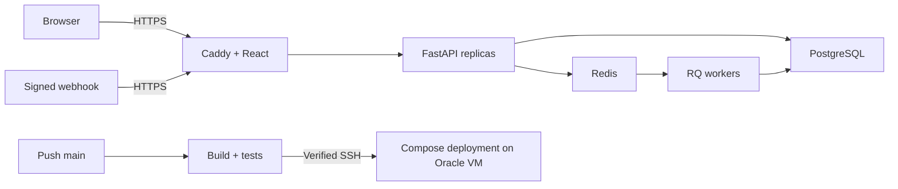

# Mistraton

Repo for the Mistral hackathon. A deployable React/Vite TypeScript frontend, FastAPI backend, RQ workers, Redis, PostgreSQL, and Caddy HTTPS, targeting the existing Oracle VM **130.162.187.46**.

**Start with [the step-by-step setup guide](docs/SETUP.md).** It covers DuckDNS registration, Oracle networking, Ubuntu/Oracle Linux, SSH keys, GitHub secrets, first deployment, and validation. No VM login or DuckDNS changes are performed by this repository.



## Run locally

Install a Docker engine with Compose v2.24+ (or newer major), Python 3.9+, and Bash. On macOS, a free local Docker engine such as Colima can be used; Docker Desktop licensing depends on your organization. Python 3.12 runs inside the backend container.

```bash
git clone https://github.com/irumata/Mistraton.git
cd Mistraton
python3 scripts/configure.py --local
bash scripts/up.sh
python3 scripts/smoke.py
```

Open **http://localhost:8080**. Take `ADMIN_API_KEY` from your private `.env` and enter it in the demo form. The browser holds it only in memory. The demo uppercases your message in a separate worker and persists the result in PostgreSQL.

If you already have `.env`, edit it; the generator deliberately refuses to overwrite it. To stop: `bash scripts/compose.sh stop`. Do not use `down --volumes` on a real deployment: that deletes the database, queue and certificates.

## Deploy and scale

After the [one-time setup](docs/SETUP.md), pushing `main` runs checks and deploys the checked commit. The source is uploaded through SSH and images build natively on the VM, supporting both Arm64 and AMD64 without a container registry. Private-repository CI and deployment start disabled until you enable `CI_ENABLED` and `DEPLOY_ENABLED`.

Change `API_REPLICAS` and `WORKER_REPLICAS` in the VM's `~/hackathon/shared/.env`, then run `bash ~/hackathon/current/scripts/up.sh`. Caddy discovers API replicas through Docker DNS. API and worker containers have no persistent local application data; PostgreSQL and Redis have separate named volumes.

## Included

| Area | Files / behavior |
|---|---|
| Frontend | `frontend/`: React, TypeScript, Vite, responsive job demo |
| API | `backend/app/`: protected job submit/status, public health/readiness |
| Background work | JSON-serialized RQ jobs, durable PostgreSQL results, bounded job timeout |
| Integrations | Signed example `/webhooks/demo`; adapt provider verification before connecting a messenger |
| Storage | PostgreSQL SQL migrations, Redis AOF, persistent Caddy certificates |
| Deployment | Exact-commit SSH upload, verified host key, deployment lock, pre-migration DB backup, job check |
| Operations | [Backups, restores, recovery and scaling](docs/OPERATIONS.md) |
| Security | [Trust boundaries and deployment limitations](docs/SECURITY.md) |
| Validation | [What was actually checked](docs/VALIDATION.md) |

The code does not provision cloud resources, purchase a domain, register a messenger, or call a paid API. The £0 target depends on staying within your current Oracle allocation and GitHub allowance; see the setup guide's cost controls.
